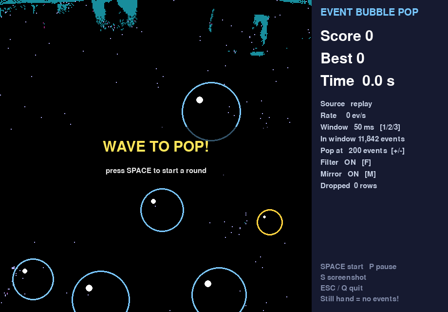

# Event Bubble Pop

A live game for the [GENX320 event camera](https://openmv.io/products/genx320-event-camera) on an OpenMV H7 Plus. Bubbles float up over the live event view, and you pop them by waving your hand through them. If any bubble reaches the top, the game is over.

A hand held still pops nothing: an event camera reports only **changes** in brightness, not images.



Event Bubble Pop is part of the [Event Sensor Course](https://esc.e3computing.org/) (University of Aizu). It also works as a small template for your own event-camera project.

## What you need

| Item | Notes |
|---|---|
| OpenMV H7 Plus + GENX320 event camera | Firmware 5.0.0 or newer (tested with 5.0.1) |
| USB **data** cable | Charge-only cables do not work |
| Computer with Python 3.12+ | Tested on macOS (Apple Silicon); Linux and Windows should work |

No board? You can still play a recorded CSV file with `--replay` (see below).

## Setup

```sh
git clone https://github.com/EventSensorCourse/event_bubble_pop.git
cd event_bubble_pop
python3.12 -m venv .venv
source .venv/bin/activate          # Windows: .venv\Scripts\activate
python -m pip install -r requirements.txt
```

You do not need to put anything on the board yourself: the game uploads the camera script over USB each time it starts.

After `git pull`, run `python -m pip install -r requirements.txt` again; new versions can add packages (for example `numba` for the raw stream formats).

## Run

1. If OpenMV IDE is connected to the board, stop the script and **disconnect the IDE**. Keep the USB cable plugged in.
2. Start the game:

   ```sh
   python bubble_pop.py
   ```

   The game looks for the OpenMV port automatically. If it cannot find it, list the ports and pass yours:

   ```sh
   python -m serial.tools.list_ports -v
   python bubble_pop.py --port /dev/cu.usbmodem123456     # macOS example
   python bubble_pop.py --port COM5                       # Windows example
   ```

3. Press **SPACE** to start a round, then wave to pop the bubbles.

### Keys

| Key | Action |
|---|---|
| SPACE | Start a round; it ends when a bubble reaches the top |
| 1 / 2 / 3 | Time window 10 / 50 / 100 ms |
| F | Noise filter on or off |
| M | Mirror view (on by default, like a selfie camera) |
| + / − | Pop threshold (steps of 20; default 200 events per 50 ms) |
| P | Pause |
| S | Save a screenshot to `recordings/` |
| ESC / Q | Quit (also stops the board script) |

### Options

| Option | Default | Meaning |
|---|---|---|
| `--port PORT` | automatic | OpenMV USB port |
| `--replay FILE.csv` | — | Play a recording instead of the live camera (loops) |
| `--window-ms {10,50,100}` | 50 | Time window length in sensor time |
| `--threshold N` | 200 | Events inside a bubble per 50 ms needed to pop it |
| `--format {processed,evt20,evt21,evt30}` | processed | USB stream format; `evt20` carries the most events (see below) |
| `--fifo-depth 2-8` | 8 | Board buffers; lower means less delay but more events dropped |
| `--no-mirror` | off | Show the raw sensor orientation |
| `--seconds N` | 0 (no limit) | Quit automatically after N seconds |

### Replay a recording

```sh
python bubble_pop.py --replay my_recording.csv
```

The CSV needs the header `type,sec,msec,usec,x,y` (OpenMV viewer snapshots with `type,sec,ms,us,x,y` also work). It plays at the recorded speed and loops.

## How it works

```text
GENX320 → H7 Plus → USB batches → TimeWindows → denoise → pop bubbles → screen
```

| File | Role |
|---|---|
| `bubble_pop.py` | Game: event processing, bubbles, drawing |
| `event_stream.py` | Live camera stream, CSV replay, and time windows |
| `benchmark_formats.py` | Measures events/s and delay for each stream format on your board |
| `third_party/openmv/` | OpenMV's official camera scripts and raw decoders (MIT) |
| `tests/` | Desktop checks; no board needed |

Every finished time window goes to `Game.process_window()`:

1. `denoise()` removes isolated events. Real edges are connected; sensor noise is scattered.
2. `active_fraction()` detects a light change: if too many pixels fire at once, it is not a hand, and nothing pops.
3. `events_inside()` counts the events inside each bubble. If the count reaches the threshold, the bubble pops.

Windows use **sensor timestamps**, so a 50 ms window means 50 ms of sensor time, even when it spans several USB batches. The threshold scales with the window length, so the difficulty stays similar at 10, 50, and 100 ms.

## Lag, noise, and tuning

**Bubbles pop by themselves.** Raise the threshold (+ or `--threshold 300`), keep the filter on (F), and avoid flickering lights.

**Nothing pops.** Lower the threshold (−), move faster, or add contrast between your hand and the background.

**The display lags behind your hand during fast motion.** The cause is the USB link, not the game code. The H7 Plus connects at USB Full-Speed, which carries roughly 50–80k events/s in this mode (12 bytes per event). A waving hand produces more than that, so the extra events wait in the board's buffers:

```text
GENX320 → camera buffers (8) → event buffers (8) → USB Full-Speed → PC → game
                └──── events wait here when USB is full ────┘
```

Measured on an H7 Plus (macOS, firmware 5.0.1):

| Scene | Buffers | Received rate | Delay to the PC |
|---|---:|---:|---:|
| Quiet | 8 (default) | ~14k events/s | 3–16 ms |
| Busy | 8 (default) | ~56k events/s; USB full | rises to ~700 ms |
| Quiet | 2 | ~30k events/s | 14–42 ms |
| Busy (fast waving) | 2 | ~69k events/s; USB full | 31 ms median (11–37 ms) |

Processing one window takes only 2–4 ms on the PC. To trade completeness for lower delay, run:

```sh
python bubble_pop.py --fifo-depth 2
```

With fewer buffers the board **drops** the extra events instead of queuing them. The minimum is 2. The side panel shows the received rate and the rows dropped on the PC side. A smooth display does not prove that every sensor event was captured.

## Stream formats: more events through the same USB

Processed mode spends 12 bytes on every event. The raw sensor formats send fewer bytes per event, and the PC decodes them into the same `(N, 6)` array, so the game does not change:

```sh
python bubble_pop.py --format evt20 --fifo-depth 2
```

| `--format` | USB data | Note |
|---|---|---|
| `processed` (default) | 12 bytes per event, decoded on the board | Simplest |
| `evt20` | 4 bytes per event + timing words | Best in our tests |
| `evt21` | 8 bytes for up to 32 events on one row | Never better than `evt20` in our tests |
| `evt30` | Compressed 16-bit words | Close second with large moving objects |

Measured with a hand waving for the whole run (2 buffers, H7 Plus, firmware 5.0.1, 2026-11-04):

| `--format` | Events/s received | Bytes per event | Median delay |
|---|---:|---:|---:|
| `processed` | ~69k (USB full) | 12.0 | 31 ms |
| **`evt20`** | **~174k** | **4.2** | **3 ms** |
| `evt21` | ~87k | 8.4 | 4 ms |
| `evt30` | ~158k | 4.8 | 3 ms |

EVT2.0 delivered about 2.5× more events than Processed. EVT3.0 was close behind with a waving hand, but much worse when the room's events were scattered single pixels; in a quiet room all formats were equal. Full results, method, and limits: [docs/FORMATS.md](docs/FORMATS.md).

Measure your own scene (formats run in turn, several rounds):

```sh
python benchmark_formats.py --seconds 6 --rounds 3 --scene "waving" --fifo-depth 2
```

## Use it for your own project

Copy `bubble_pop.py` and replace the processing in `process_window()` with your own algorithm. Keep `event_stream.py` unchanged. The smallest loop:

```python
from event_stream import CameraStream, TimeWindows, pixel_events

windows = TimeWindows(50)                      # 50 ms of sensor time
with CameraStream("/dev/cu.usbmodem123456") as stream:
    while True:
        for batch in stream.batches():         # (N, 6): type, sec, msec, usec, x, y
            for start_us, events in windows.add(pixel_events(batch)):
                print(start_us, len(events))   # your algorithm here
```

Use `ReplayStream("file.csv")` instead of `CameraStream(...)` to develop with recorded data, and `CameraStream(port, fmt="evt20", fifo_depth=2)` for more events and lower delay. Process whole windows with NumPy; do not print every event.

## Tests

```sh
python -m unittest discover -s tests -v
```

These check processed and raw (EVT2.0/2.1/3.0) decoding, full timestamps, time windows across batches, denoising, popping and light-change logic, CSV replay, camera-script patching, and drawing. USB behaviour needs a real board.

## Troubleshooting

| Symptom | Check |
|---|---|
| "No OpenMV board found" | Use a USB data cable, connect directly (not through a hub), pass `--port` |
| Port busy | Disconnect OpenMV IDE and close other programs using the board |
| Camera traceback / no events channel | Firmware 5.0.0+ with GENX320 support; reconnect the board |
| Always "Light change" | A flickering lamp; change the lighting |
| No sound | The game runs silently if no audio device is available |

## Credits

- Event Sensor Course, University of Aizu.
- The camera scripts and raw decoders in `third_party/openmv/` and the adapted helpers in `event_stream.py` come from [OpenMV's GENX320 event streaming example](https://github.com/openmv/openmv-projects/tree/fd10126a6acf9e1eeffb5bed8fd14c79c1943947/tools/genx320-event-streaming) (MIT license; see `third_party/openmv/LICENSE`).

## License

MIT License; see [LICENSE](LICENSE). The files in `third_party/openmv/` keep OpenMV's own MIT license ([third_party/openmv/LICENSE](third_party/openmv/LICENSE)).
